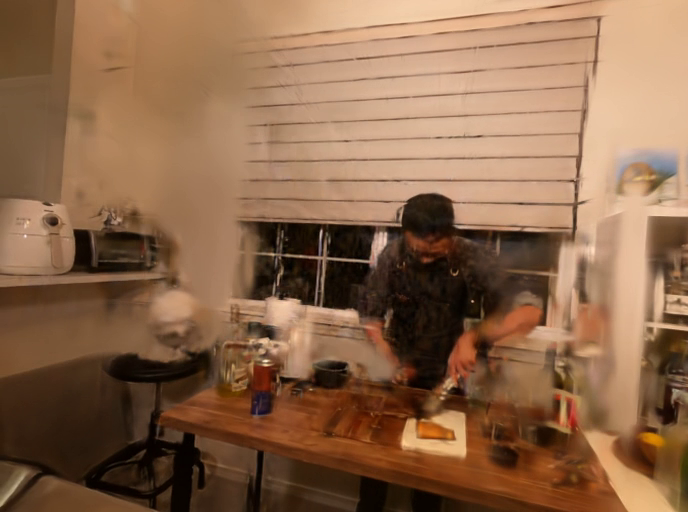
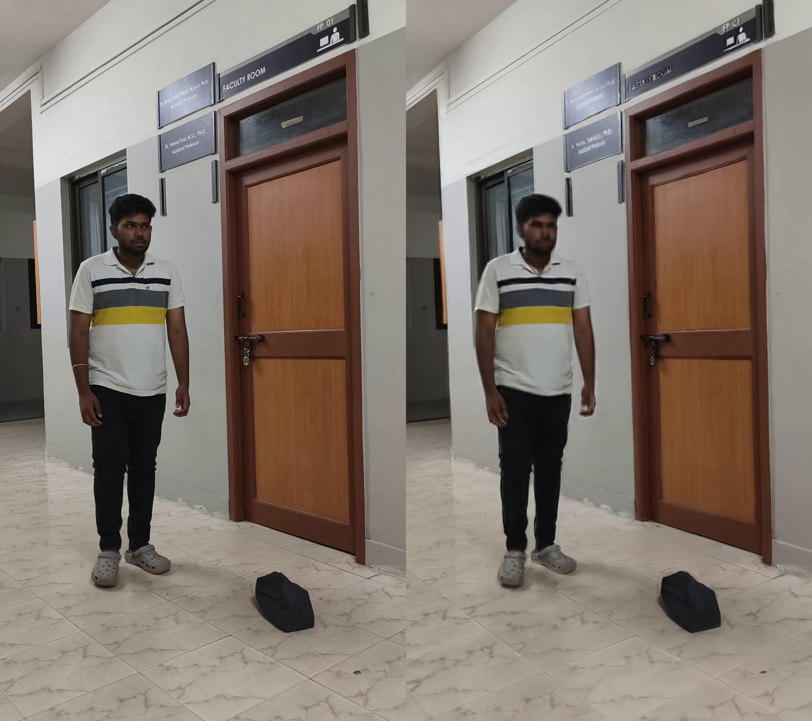
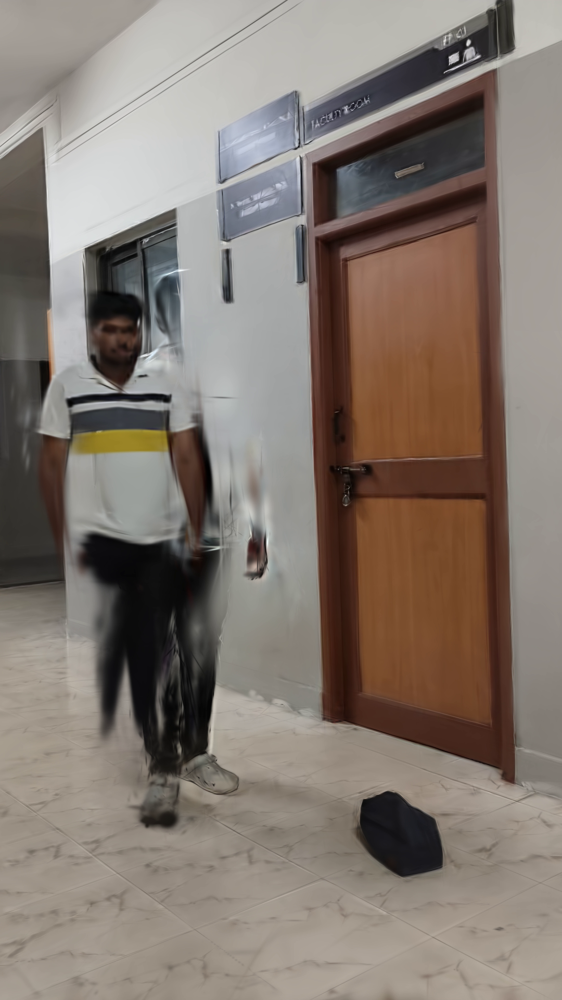
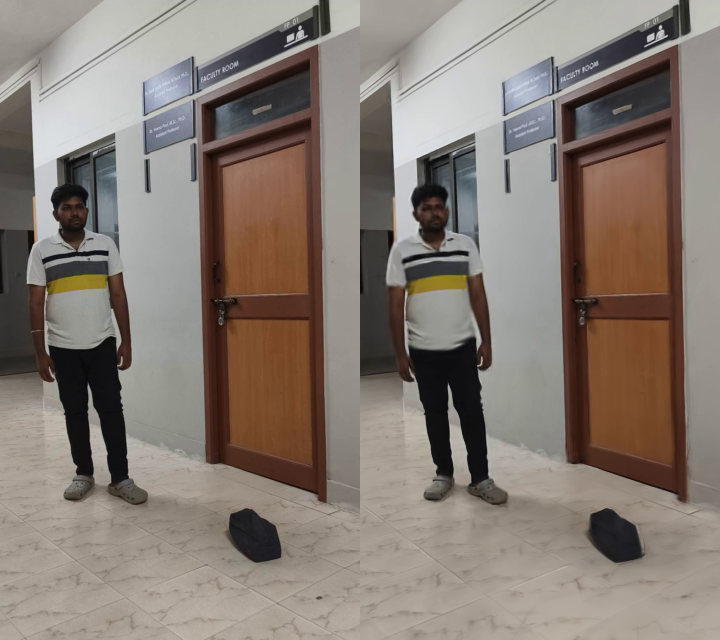

<div align="center">

# 4D Video: Dynamic Scene Reconstruction & Traversable Video Format

[](https://github.com/sharvan-m/4D_Scene_Reconstruction_and_A_Traversable_Video_Format.git)
[](#technology-stack)
[](#hardware--environment)
[](4DV-Viewer/)

**A comprehensive framework for reconstructing dynamic 3D scenes across time from multi-view video footage into a lightweight, interactive, traversable 4D video format.**

</div>

---

## 📖 1. Project Overview & Problem Statement

Conventional video captures dynamic scenes as flat 2D pixel grids constrained to a single fixed camera trajectory. Viewers cannot change perspectives, inspect occluded angles, or freely navigate the spatial volume as events unfold.

**4D Video** bridges this gap by combining spatial dimension (3D) and temporal progression (time $\to$ 4D). Using **4D Gaussian Splatting (4DGS)**, the scene is modeled as dynamic anisotropic 3D Gaussians that deform, translate, and vary opacity continuously over time. The result is exported into `.4dv`, a compact traversable format rendered directly inside a WebGL2 browser environment without specialized client-side hardware or heavy cloud streaming.

```
Input Multi-View Videos
       │
       ▼
Preprocessing & Camera Poses (COLMAP / Poses)
       │
       ▼
4D Gaussian Splatting Optimization (Space + Time)
       │
       ▼
Traversable Binary (.4dv)
       │
       ▼
Interactive WebGL2 Viewer (4DV-Viewer)
```

---

## ✨ 2. Key Features

- **Dynamic Temporal Reconstruction:** Models continuous motion, non-rigid deformations, and high-frequency dynamic details over time.
- **Novel View Synthesis & Free-Viewpoint Exploration:** Render novel camera trajectories in real time from arbitrary angles.
- **Compact Traversable Video Format (`.4dv`):** Quantized spatial and velocity representations for lightweight streaming and distribution.
- **Zero-Dependency WebGL2 Player (`4DV-Viewer`):** Instant browser playback with real-time orbit controls, timeline scrubbing, and multi-camera switches.
- **Complete Automated Toolchain:** Scripts covering dependency builds, training resumes, CUDA memory sanitization, and dataset inspection.

---

## 🛠️ 3. Technology Stack

| Component | Technology | Purpose |
| :--- | :--- | :--- |
| **Language** | Python 3.7+ / C++ / CUDA | Pipeline logic & custom GPU compute kernels |
| **Deep Learning** | PyTorch 1.12.1+ / CUDA 11.6 | Model optimization & tensor computation |
| **CUDA Extensions** | `diff-gaussian-rasterization`, `simple-knn`, `pointops2` | Differentiable tile rasterization & nearest neighbors |
| **Structure-from-Motion** | COLMAP | Camera extrinsics/intrinsics & sparse point estimation |
| **Interactive Viewer** | WebGL2 / GLSL shaders / Vanilla JS | Browser-based interactive scene navigation |

---

## 📂 4. Repository Structure

```text
4D-VIDEO/
├── 4D-Gaussian-Splatting/       # Core 4D Gaussian Splatting neural reconstruction codebase
│   ├── arguments/              # Model parameters and pipeline configurations
│   ├── configs/                # Dataset-specific training YAML recipes (dynerf, dnerf)
│   ├── diff-gaussian-rasterization/ # Differentiable CUDA rasterizer extension
│   ├── simple-knn/             # Spatial indexing and k-NN CUDA extension
│   ├── pointops2/              # Point transformer and attention kernels
│   ├── scene/                  # Dynamic scene management & COLMAP dataset readers
│   ├── utils/                  # Camera utilities, losses, and image processing
│   └── train.py                # Primary 4DGS optimization entry point
│
├── 4DV-Viewer/                 # Interactive WebGL2 player for .4dv files
│   ├── index.html              # Main application interface
│   ├── css/                    # Dark-themed responsive styles
│   ├── js/                     # WebGL2 rendering shaders & 4DV binary decoder
│   ├── assets/                 # Sample demo scenes (e.g. hacknex.4dv)
│   └── README.md               # Viewer guide and feature list
│
├── scripts/                    # Workflow automation scripts
│   ├── build/                  # CUDA extension compile scripts (build_knn.bat, clean_build_dgr.bat)
│   ├── training/               # 4DGS training launchers, resumes, and benchmarks
│   ├── preprocessing/          # Dataset frame extractors and post-processors
│   ├── diagnostics/            # COLMAP checks, import testers, and GPU sanitizers
│   └── README.md               # Guide to execution scripts
│
├── tools/                      # Standalone Python utility tools
│   ├── inspect_data.py         # Verify frame resolution, camera bounds, and timestamps
│   ├── gen_initial_ply.py      # Initialize 3D point cloud bounds
│   ├── vidinfo.py              # Video stream & metadata extractor
│   ├── test_imports.py         # PyTorch & CUDA extension import validator
│   └── README.md               # Tool documentation
│
├── assets/                     # Presentation assets and visual benchmarks
│   └── screenshots/            # Flythroughs, timesweeps, and side-by-side renders
│
├── check/                      # Multi-camera visual verification stereo pairs
│   ├── pair_01.png
│   ├── pair_02.png
│   └── README.md
│
├── README.md                   # Repository documentation
├── .gitignore                  # Git exclusions for builds, checkpoints & heavy videos
└── .gitattributes              # Git LFS configuration
```

---

## ⚡ 5. Installation & Setup

### Environment Requirements
- **OS:** Windows 10/11 (64-bit)
- **GPU:** NVIDIA GPU with CUDA Compute Capability $\ge$ 7.5 (e.g. RTX 3050, 3060, 4000 series)
- **Compiler:** Visual Studio 2022 C++ Build Tools (MSVC 14.44 / vcvarsall x64)
- **Conda Environment:** Python 3.7.13, PyTorch 1.12.1, CUDA Toolkit 11.6

### Quick Setup
1. Clone the repository:
   ```bash
   git clone https://github.com/sharvan-m/4D_Scene_Reconstruction_and_A_Traversable_Video_Format.git
   cd 4D_Scene_Reconstruction_and_A_Traversable_Video_Format
   ```
2. Build CUDA extensions:
   ```cmd
   scripts\build\build_knn.bat
   scripts\build\clean_build_dgr.bat
   ```
3. Test environment & imports:
   ```cmd
   scripts\diagnostics\test_imports.bat
   ```

---

## 🚀 6. Running the Pipeline

### 1. Preprocessing Video Sequences
Extract synchronized frames and derive camera poses:
```cmd
scripts\preprocessing\run_preprocess.bat
```

### 2. Training 4D Gaussian Splatting
Train a dynamic scene from extracted frames and camera poses:
```cmd
scripts\training\run_train4.bat
```
To resume interrupted training or run high-resolution optimization:
```cmd
scripts\training\run_train4_resume.bat
scripts\training\run_train_ours_hr.bat
```

### 3. Launching the Interactive 4DV Viewer
Open `4DV-Viewer/index.html` directly in any modern browser, or launch via local server:
```bash
python -m http.server 8000
```
Navigate to `http://localhost:8000/4DV-Viewer/` and drop any `.4dv` file into the player window.

---

## 📊 7. Visual Demos & Results

| Free Viewpoint Flythrough | Ground Truth vs. Render |
| :---: | :---: |
|  |  |

| Temporal Sweep Exploration | Multi-View Inspection |
| :---: | :---: |
|  |  |

---

## 📋 8. Project Implementation Status

- [x] Multi-view camera synchronization and pose estimation integration.
- [x] Core 4D Gaussian Splatting training pipeline and dynamic deformation modeling.
- [x] WebGL2 `.4dv` format parser and interactive orbit camera player.
- [x] Automated compilation scripts and environment diagnostics for Windows.
- [ ] Automated web-based streaming of compressed `.4dv` chunks over HTTP.
- [ ] Integration of real-time semantic segmentation on dynamic splats.

---

## 📚 9. References & Acknowledgments

- **4D Gaussian Splatting (4DGS):** Wu et al., *4D Gaussian Splatting for Real-Time Dynamic Scene Rendering*, 2023.
- **3D Gaussian Splatting:** Kerbl et al., *3D Gaussian Splatting for Real-Time Radiance Field Rendering*, SIGGRAPH 2023.
- Built for dynamic video reconstruction and novel view synthesis applications.
